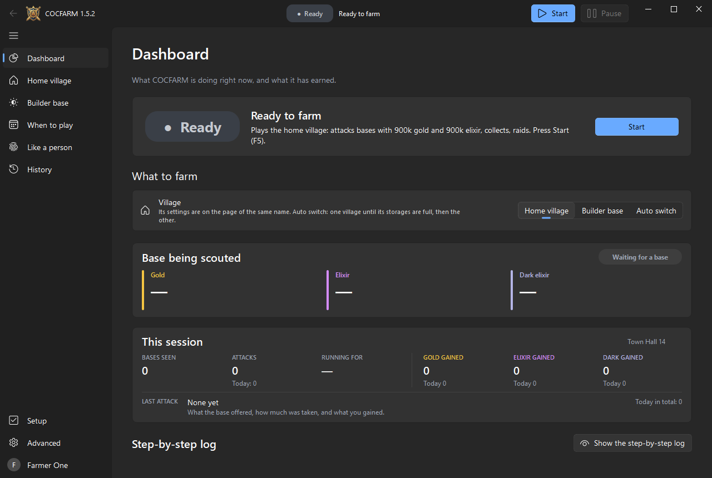
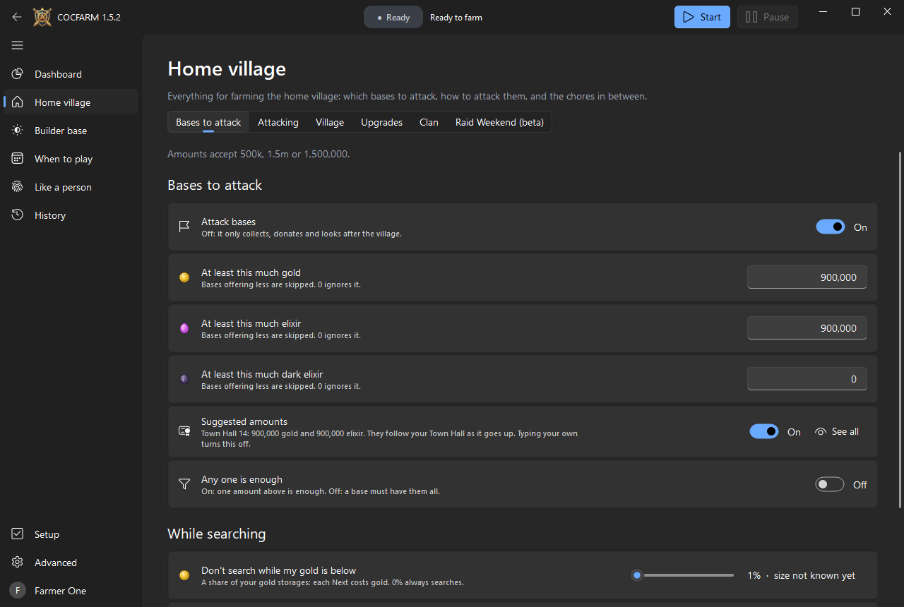
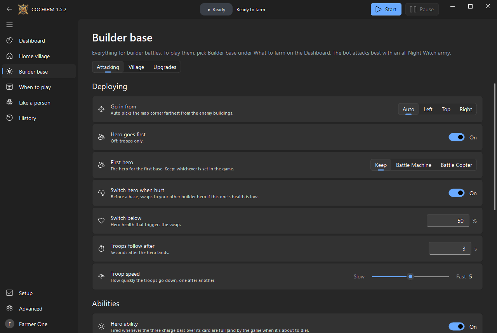
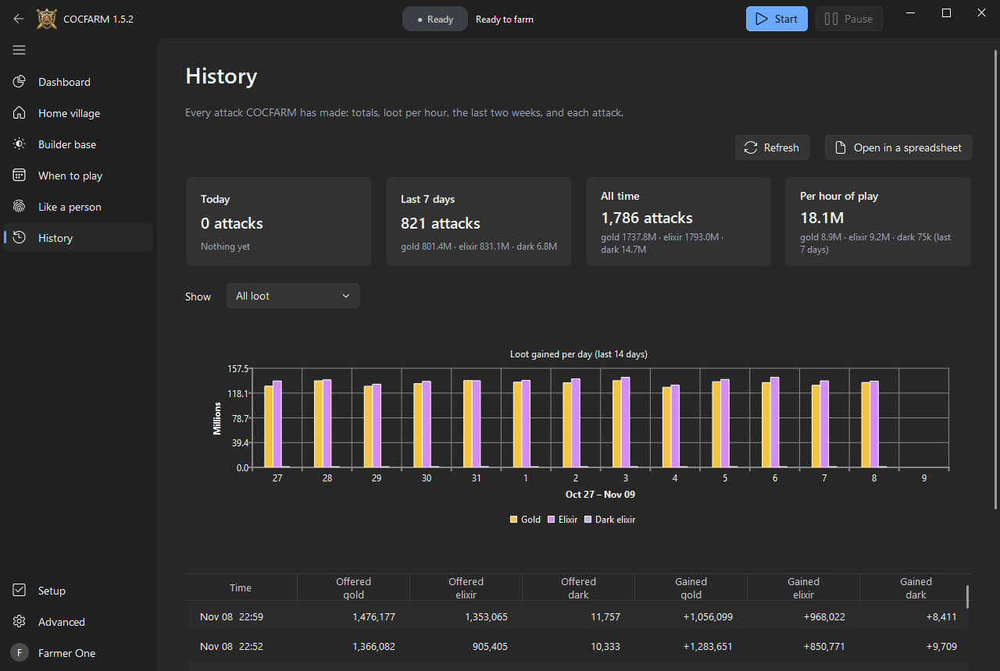
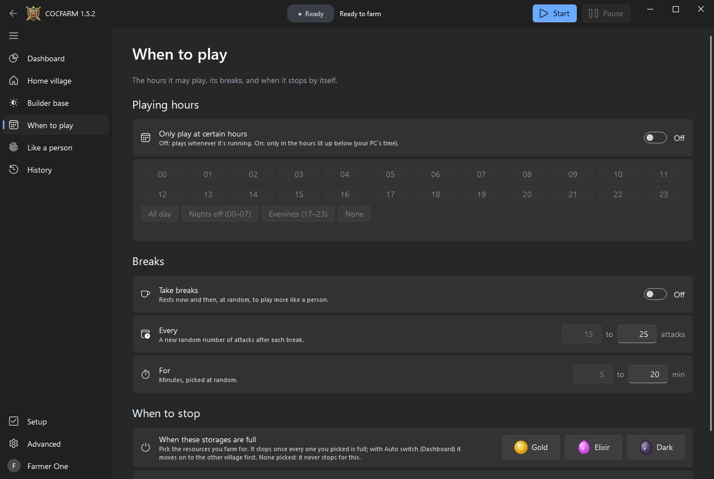
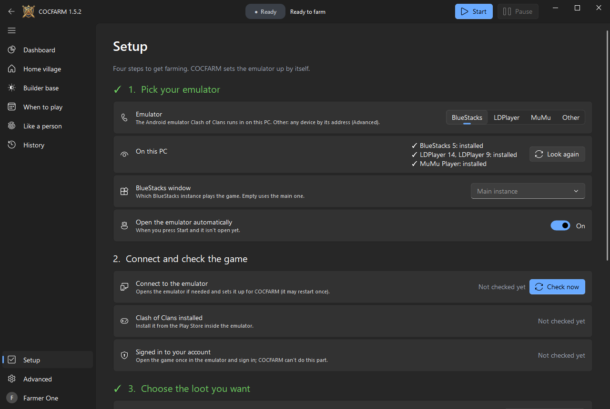

# COCFARM

> [!NOTE]
> **Not affiliated with, endorsed by, or connected to Supercell.** Clash of Clans is a trademark of Supercell Oy.


**A Clash of Clans farming bot for Windows.** It plays the game for you on an
Android emulator (BlueStacks, LDPlayer or MuMu Player): it attacks, collects your loot and
looks after your village, in **both the home village and the builder base**.

[](https://github.com/BilinP/COCFARM/actions/workflows/windows-exe.yml)

**[⬇ Download the latest release](https://github.com/BilinP/COCFARM/releases/latest)** · [All releases](https://github.com/BilinP/COCFARM/releases)

> [!WARNING]
> **Using this bot can get your Clash of Clans account banned.** Botting breaks
> Supercell's Terms of Service, and Supercell bans accounts it catches,
> temporarily or for good. Only use it on an account you're willing to lose.



## What it does

**Farming**
- ⚔️ **Farms the home village.** It finds bases with the loot you want, sends out every troop, hero and spell in your army, fires the heroes' abilities, and comes home. It can activate your **super troops** before a battle, paying with dark elixir.
- 🎯 **Deploys right at the red line.** Troops land just outside the red line, or just outside the buildings where it can't be seen, not out at the map's edge.
- 🏰 **Fits your Town Hall.** Loot to look for starts at amounts for your Town Hall, and what it hasn't unlocked yet is greyed out. Your village (from the game's Data Export) is a click away.
- 🛠️ **Farms the builder base.** It plays both stages of builder battles with your hero and troops (an all **Night Witch** army works best), fires the hero's ability when it's charged, and uses the **Clock Tower**'s free boost.
- 🔄 **Switches between villages for you.** With **Auto switch** on, it farms one village until its storages are full, then moves to the other.
- 🏰 **Raids the Clan Capital (beta).** On Raid Weekends it uses every raid attack with the capital army you set in the game.

**Looking after your village**
- 💰 **Collects everything.** Resources, the loot cart, and in the builder base the gem mine and the elixir cart.
- 🧱 **Spends your spare loot (if you turn it on).** It upgrades as many walls as the spare covers, all at once. When a storage is full it starts the dearest upgrades it can pay for: buildings and heroes in the order you pick, research and pets. This works in both villages and never uses gems.
- 🤝 **Helps your clan.** It fills donation requests with troops and spells suited to each requester's Clan Castle level, and requests troops for you.

**Running it**
- 👥 **Farms several accounts at once (beta).** Switch on a farm for each emulator instance (LDPlayer, MuMu or BlueStacks, mixed as you like), all from one page. Each account keeps its own settings, picked by the player name in the game.
- ⏰ **Plays when you want.** You pick the hours, a daily attack range and random breaks, so it plays more like a person.
- 🛟 **Recovers by itself.** If the game gets stuck it restarts it, and if the emulator stops answering it restarts that too. It stops with the reason during a Clash of Clans maintenance break.
- 🧑 **Plays like a person.** Switch on habits one by one (taps around a button, varied pauses and swipes, a battle rhythm of its own) and see how much time each adds.
- 📊 **Tracks your loot.** The History page shows every attack and what you gained.
- 🔔 **Sends Discord alerts.** You'll hear when storage is full, when it stops (with a summary of the run), and get a daily summary.
- ⬆️ **Updates itself** from GitHub releases, in one click, and shows what's new afterwards. It also adds itself to the Start menu, and to Installed apps so you can uninstall it.

## Get started

1. **Install an emulator** ([BlueStacks 5](https://www.bluestacks.com/),
   [LDPlayer 9 or 14](https://www.ldplayer.net/), or [MuMu Player](https://www.mumuplayer.com/))
   and sign in to Clash of Clans in it. **Set the game to English** (Settings → Language): COCFARM
   finds its buttons by their English words. Windows itself can be in any language.
2. **Download COCFARM.** Get `COCFARM-windows.zip` from the
   [latest release](https://github.com/BilinP/COCFARM/releases/latest) and unzip it anywhere.
3. **Open `COCFARM.exe`.** If Windows warns you, click **More info → Run anyway**.
4. **Follow the Setup page.** Pick your emulator, press **Check now**, and choose the loot you want.
   COCFARM sets the emulator up by itself.
5. **Press Start** (or F5). That's it.

**Updating:** COCFARM tells you when a new version is out. Press **Update now**, then
**Restart and update** once it's downloaded. Your settings, history and pictures are kept.
You can also check by hand under **Advanced → Settings → Updates**.

### Tested emulators

Home village and builder base attacks were tested live on each of these (COCFARM 0.6.0):

| Emulator | Version | Android |
|---|---|---|
| BlueStacks 5 | 5.22.110.1028 (Pie 64-bit) | 9 |
| LDPlayer 9 | 9.5.25.0 | 9 |
| LDPlayer 14 | 14.0.29.2 | 14 |
| MuMu Player | 6.8.9.0 (COCFARM 0.9.0) | 15 |

Other versions will likely work too. If yours doesn't, please
[report it](https://github.com/BilinP/COCFARM/issues/new/choose) with the emulator and its version.
Run one emulator at a time: BlueStacks and LDPlayer use the same connection port.
COCFARM sets the emulator's screen (860 × 672), CPU cores and memory by itself; you can turn that off under **Advanced**.

### Several accounts at once (beta)

Each farm plays one emulator instance and keeps to the account signed in there. Farms can mix
emulators: LDPlayer, MuMu Player and BlueStacks side by side. All of them run from the **Farms** page, which
opens from the account at the bottom left of the side bar:

1. **Farms** lists every emulator instance on this PC. Switch one on and it becomes a farm. To make another
   instance, press **New instance** and pick an emulator. On LDPlayer and MuMu, it copies the last farm's
   instance, game included. On BlueStacks, COCFARM opens the **Multi-Instance Manager**: clone an instance
   there, and COCFARM adds the farm once it appears. The bin on an instance's row deletes it from the
   emulator, after asking (an emulator's first instance is never deleted).
2. The copy is signed in to the same account. Open it once and switch to another account with Supercell ID.
   It stays on that account from then on.
3. Pick the farms to run with their switches, then press **Start**. **Stop** switches them all off, each after
   its current step. While farms run, a switch starts or stops its own farm too. A farm finds its account's
   profile by the player name it sees.

**View** shows a farm in the main window. Every farm keeps farming while another one is shown. The small
square button opens a farm in a window of its own; closing that window switches the farm off. Each instance
needs about 2 CPU cores and 4 GB of memory.

## A quick look

| Home village | Builder base |
|---|---|
|  |  |
| Pick the loot a base must have, how to attack, and village chores. | Pick how builder battles are played. |

| History | When to play |
|---|---|
|  |  |
| Every attack, daily totals, and a chart you can hover for exact numbers. | Playing hours, breaks, and when to stop. |



## Tips

- **Spending loot is off by default:** turn on walls and upgrades under
  **Home village → Village** (and **Builder base → Village**), and set how much to keep.
- **Super troops:** switch on **Activate super troops** under **Home village → Attacking**.
  It pays 25,000 dark elixir for each, and never uses a Super Potion or gems.
- **Builder base army:** train only Night Witches.
- **Spells:** by default it casts only **Bat Spells**, all at once on one spot: the middle of the base,
  or a random spot near the middle each battle. Switch to **All spells** under
  **Home village → Attacking**.
- **Check what the bot sees:** scout a base in the game, then press
  **What the bot sees** under **Advanced**.
- **Keyboard shortcuts:** F5 starts, Esc pauses, and Ctrl+1 to Ctrl+7 switch pages.

## Something went wrong?

The Dashboard tells you what happened in plain words, with a button to fix it.
If the game gets stuck, COCFARM restarts it by itself, and restarts the emulator if needed
(up to three times). After three failed rounds in a row, it stops and says why.
For more detail, check `logs/farmbot.log` and the screenshots in `screens/errors/`
in the COCFARM folder.

## Community

Questions, ideas and results go in [**Discussions**](https://github.com/BilinP/COCFARM/discussions):

| Category | For |
|---|---|
| 📣 [Announcements](https://github.com/BilinP/COCFARM/discussions/categories/announcements) | New releases and news |
| 🙏 [Q&A](https://github.com/BilinP/COCFARM/discussions/categories/q-a) | Questions about using COCFARM |
| 🔌 [Setup and emulators](https://github.com/BilinP/COCFARM/discussions/categories/setup-and-emulators) | Installing, connecting, the Setup page |
| ⚔️ [Home village](https://github.com/BilinP/COCFARM/discussions/categories/home-village) | Searching, attacking, collecting, walls, donations |
| 🛠️ [Builder base](https://github.com/BilinP/COCFARM/discussions/categories/builder-base) | Builder battles, the hero, the elixir cart |
| 💡 [Ideas](https://github.com/BilinP/COCFARM/discussions/categories/ideas) | Feature requests (upvote the ones you want) |
| 🙌 [Show and tell](https://github.com/BilinP/COCFARM/discussions/categories/show-and-tell) | Your loot, settings and army |
| 💬 [General](https://github.com/BilinP/COCFARM/discussions/categories/general) | Anything else |

Found a bug? [Open an issue](https://github.com/BilinP/COCFARM/issues/new/choose); the form asks for what's needed to fix it.

<details>
<summary><b>For developers</b></summary>

COCFARM is written in Python. It controls the emulator over ADB, reads the
screen with OpenCV, and has a [PySide6](https://doc.qt.io/qtforpython-6/) +
[Fluent Widgets](https://github.com/zhiyiYo/PyQt-Fluent-Widgets) window.
Every setting is listed in [`farmbot.example.toml`](farmbot.example.toml).

```sh
pip install -e .
farmbot gui         # the window
farmbot run         # farm without the window
farmbot devices     # list emulator instances and their ADB ports
farmbot inspect     # show the loot, troop cards and deploy points it sees
farmbot pictures    # list the button pictures and which are missing
```

**Releases:** every push and pull request makes the
[`windows-exe`](.github/workflows/windows-exe.yml) workflow build
`COCFARM.exe` with PyInstaller and self-test it. Pushing a version tag like
`v1.2.3` also publishes it as a GitHub release under that version.

**License:** COCFARM is free software under the [GNU GPL v3 or later](LICENSE).
The libraries it bundles (Qt, Fluent Widgets, OpenCV and others) are listed with
their licenses in [THIRD_PARTY_NOTICES.md](THIRD_PARTY_NOTICES.md).

</details>
