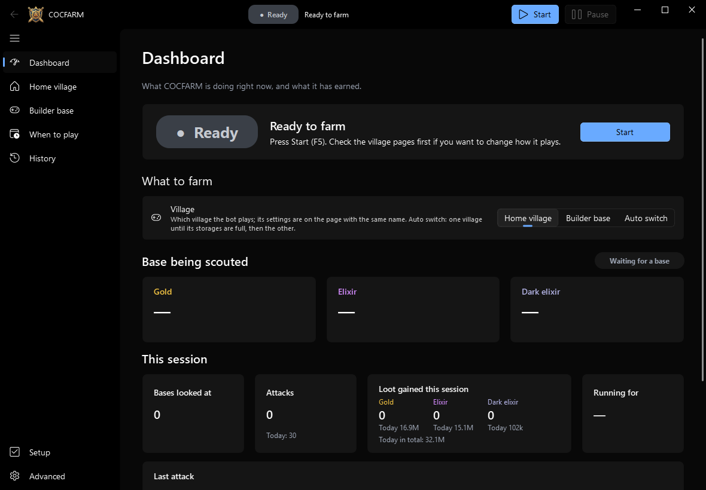
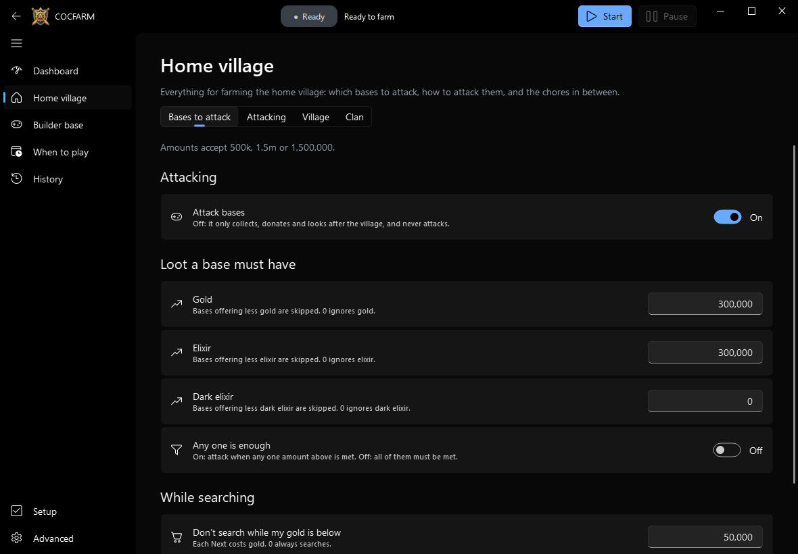
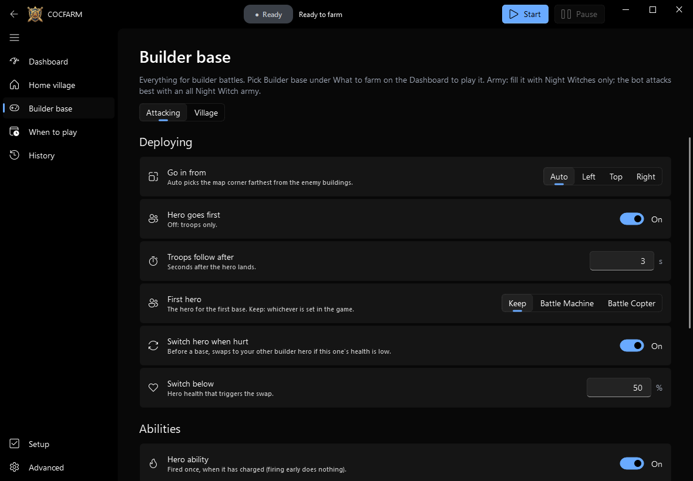
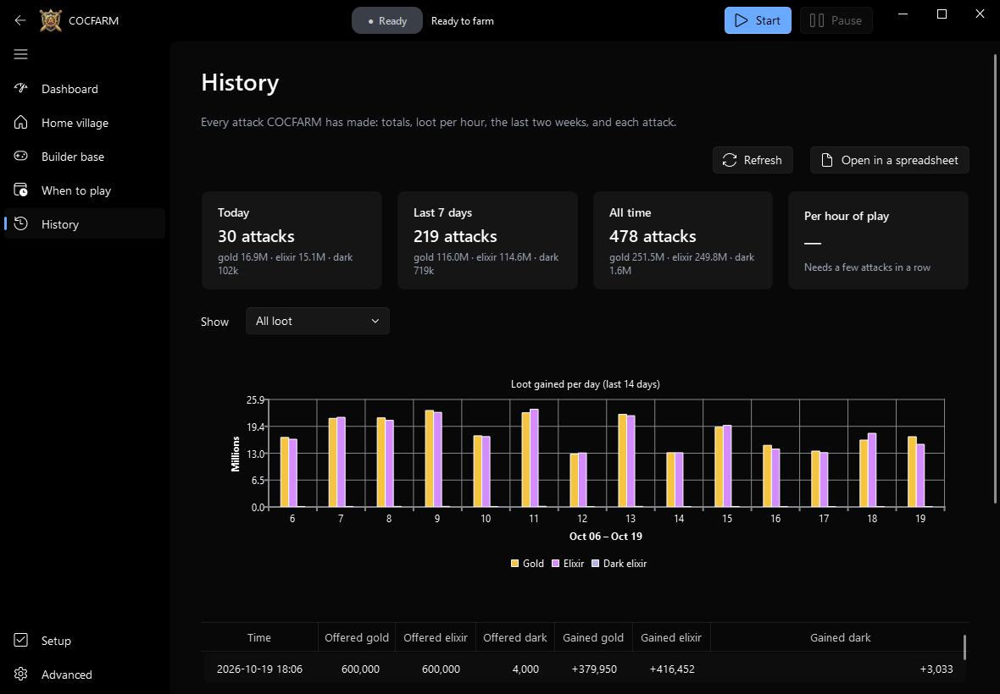
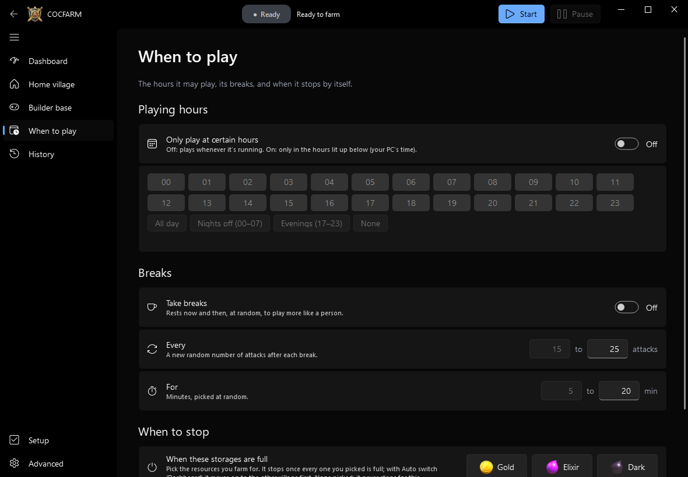
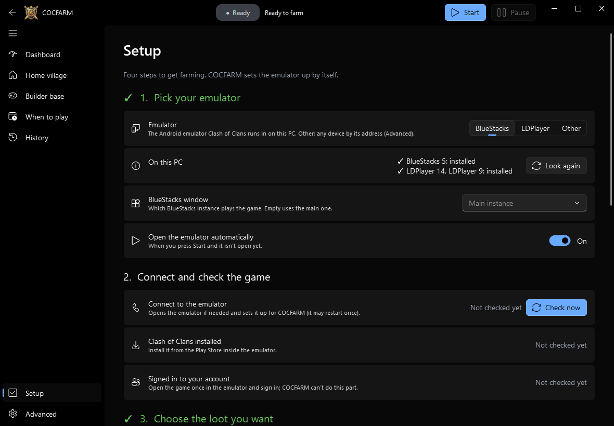

# COCFARM


**A Clash of Clans farming bot for Windows.** It plays the game for you on an
Android emulator (BlueStacks or LDPlayer): it attacks, collects your loot and
looks after your village, in **both the home village and the builder base**.

[](https://github.com/BilinP/COCFARM/actions/workflows/windows-exe.yml)

**[⬇ Download the latest release](https://github.com/BilinP/COCFARM/releases/latest)** · [All releases](https://github.com/BilinP/COCFARM/releases)

> [!WARNING]
> **Using this bot can get your Clash of Clans account banned.** Botting breaks
> Supercell's Terms of Service, and Supercell bans accounts it catches,
> temporarily or for good. Only use it on an account you're willing to lose.



## What it does

- ⚔️ **Farms the home village.** It finds bases with the loot you want, attacks with your whole army, and comes home.
- 🛠️ **Farms the builder base.** It plays builder battles with your hero and troops (an all **Night Witch** army works best).
- 🔄 **Switches between villages for you.** With **Auto switch** on, it farms one village until its storages are full, then moves to the other.
- 💰 **Looks after your village.** It collects resources and the loot cart, can upgrade walls, and fills clan donation requests.
- ⏰ **Plays when you want.** You pick the hours, a daily attack range and random breaks, so it plays more like a person.
- 📊 **Tracks your loot.** The History page shows every attack and what you gained.
- 🔔 **Sends Discord alerts.** You'll hear when storage is full, when it stops, and get a daily summary.

## Get started

1. **Install an emulator** ([BlueStacks 5](https://www.bluestacks.com/) or
   [LDPlayer 9](https://www.ldplayer.net/)) and sign in to Clash of Clans in it.
2. **Download COCFARM.** Get `COCFARM-windows.zip` from the
   [latest release](https://github.com/BilinP/COCFARM/releases/latest) and unzip it anywhere.
3. **Open `COCFARM.exe`.** If Windows warns you, click **More info → Run anyway**.
4. **Follow the Setup page.** Pick your emulator, press **Check now**, and choose the loot you want.
   COCFARM sets the emulator up by itself.
5. **Press Start** (or F5). That's it.

To update, download the new zip and unzip it over the old folder. Your settings are kept.

## A quick look

| Home village | Builder base |
|---|---|
|  |  |
| Pick the loot a base must have, how to attack, and village chores. | Pick how builder battles are played. |

| History | When to play |
|---|---|
|  |  |
| Every attack, daily totals, and a chart you can hover for exact numbers. | Playing hours, breaks, and when to stop. |



## Tips

- **Faster battles:** under **Advanced → Pictures**, add pictures of the
  **Return Home** and **Okay** buttons (the page walks you through it).
  Without them, the bot still works but each attack ends about 30 seconds slower.
- **Builder base army:** train only Night Witches.
- **Check what the bot sees:** scout a base in the game, then press
  **What the bot sees** under **Advanced**.
- **Keyboard shortcuts:** F5 starts, Esc pauses, and Ctrl+1 to Ctrl+7 switch pages.

## Something went wrong?

The Dashboard tells you what happened in plain words, with a button to fix it.
If the game gets stuck, COCFARM restarts it by itself, and restarts the emulator if needed.
For more detail, check `logs/farmbot.log` and the screenshots in `screens/errors/`
in the COCFARM folder.

<details>
<summary><b>For developers</b></summary>

COCFARM is written in Python. It controls the emulator over ADB, reads the
screen with OpenCV, and has a [PySide6](https://doc.qt.io/qtforpython-6/) +
[Fluent Widgets](https://github.com/zhiyiYo/PyQt-Fluent-Widgets) window.
Every setting is listed in [`farmbot.example.toml`](farmbot.example.toml).

```sh
pip install -e .
farmbot gui         # the window
farmbot run         # farm without the window
farmbot devices     # list emulator instances and their ADB ports
farmbot inspect     # show the loot, troop cards and deploy points it sees
farmbot pictures    # list the button pictures and which are missing
```

**Releases:** every push to `main` makes the
[`windows-exe`](.github/workflows/windows-exe.yml) workflow build
`COCFARM.exe` with PyInstaller, self-test it, and publish a GitHub release
(a version tag like `v1.2.3` publishes under that exact version).

Fluent Widgets is free under GPLv3 for non-commercial use.

</details>
